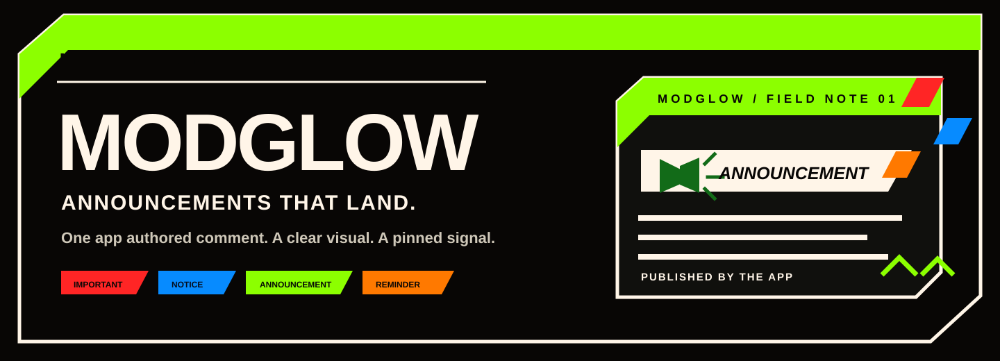
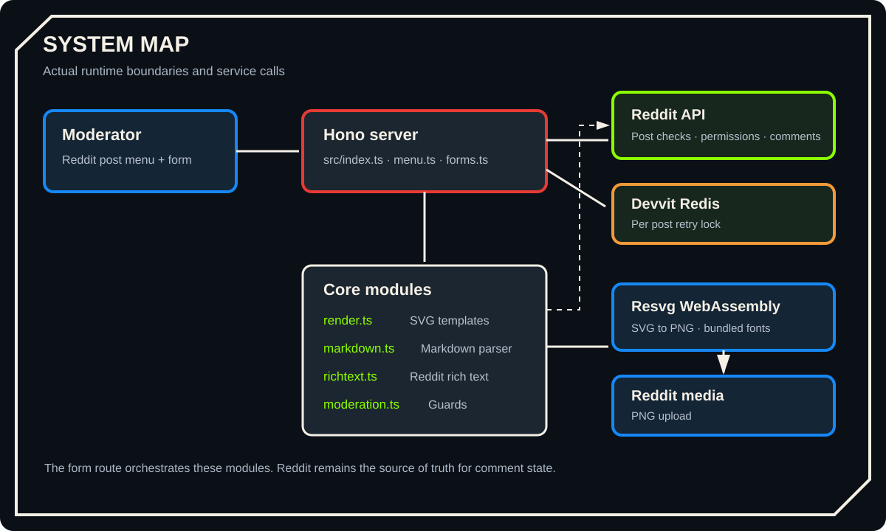
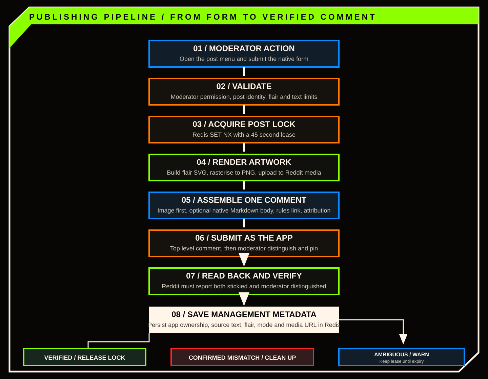
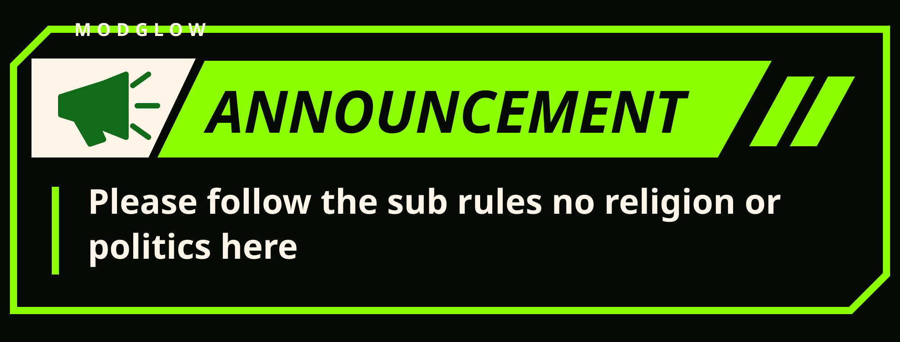
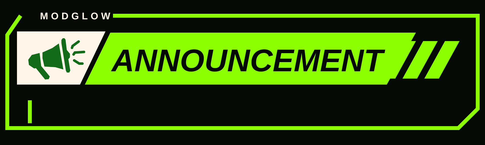
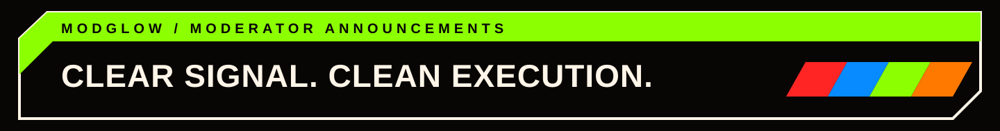

<div align="center">



[](https://github.com/Kaelith69/modglow/actions/workflows/ci.yml)
[](LICENSE)
[](https://nodejs.org/)

**Branded, moderator only announcement comments for Reddit communities.**

[How it works](#how-it-works) · [Get started](#getting-started) · [Markdown support](#markdown-support) · [Development](#development)

</div>

## Contents

- [What ModGlow does](#what-modglow-does)
- [Features](#features)
- [How it works](#how-it-works)
- [Announcement styles](#announcement-styles)
- [Markdown support](#markdown-support)
- [Getting started](#getting-started)
- [Usage](#usage)
- [Configuration and limits](#configuration-and-limits)
- [Project structure](#project-structure)
- [Technology](#technology)
- [Development](#development)
- [Security and moderation](#security-and-moderation)
- [Troubleshooting](#troubleshooting)
- [Contributing](#contributing)
- [License and third party notices](#license-and-third-party-notices)

## What ModGlow does

ModGlow is a **Reddit Devvit app for moderators**. It turns a short announcement into a branded SVG card, or pairs a title card with a fully formatted native Reddit text body. It publishes the result as one top level comment under the selected post, authored by the ModGlow app account, moderator distinguished, and pinned.

The image comes first. The explanation follows. No separate announcement post, no comment harvesting, and no mystery about who published it.

## Features

- **Four distinct announcement templates:** IMPORTANT, NOTICE, ANNOUNCEMENT, and REMINDER each have their own composition, icon, and colour palette.
- **Two publishing layouts:** put compact copy inside the image, or place a native Markdown body below a title only image.
- **Reddit native rich text:** separate body mode supports headings, emphasis, lists, quotes, code, horizontal rules, and safe HTTP or HTTPS links.
- **App authored comments:** the comment is submitted as the ModGlow app account, not as the moderator who opened the form.
- **Moderator verification:** the server checks post moderation permission and verifies the published comment is both distinguished and stickied.
- **Duplicate protection:** a short Redis lock prevents overlapping announcement submissions for the same post.
- **Defensive failure handling:** ambiguous submission or verification results are surfaced to the moderator rather than treated as a clean success.

## How it works

The app has a small server side flow. The post menu opens a native Devvit form; the form handler validates the request and moderator, prepares the image and rich text, then verifies Reddit's persisted comment state.



### Publishing sequence



1. A moderator opens a Reddit post menu and chooses **Create ModGlow announcement**.
2. They select a flair, enter Markdown, and choose where the body should appear.
3. The server checks moderator permission, validates the post and acquires a per post Redis lock.
4. ModGlow renders the SVG, rasterises it to PNG, and uploads the image to Reddit.
5. It builds one rich text comment with the image as the first content node. Separate body mode appends parsed Markdown blocks.
6. The app submits the comment, distinguishes and pins it, then fetches it again to verify both states.
7. If Reddit confirms a pin mismatch, ModGlow attempts to remove the incomplete app authored comment. If the result is ambiguous, it warns the moderator and preserves the short retry lock.

## Announcement styles

Each flair is an individual design, not one card with four paint jobs.

| Flair | Palette | Artwork |
| --- | --- | --- |
| **IMPORTANT** | Near black `#080605`, red `#FF2525`, ivory `#FFF5E8` | Warning triangle, red icon panel, ivory title panel |
| **NOTICE** | Midnight navy `#050D1C`, blue `#078BFF`, ivory `#FFF5E8` | Information symbol, blue icon panel, ivory title panel |
| **ANNOUNCEMENT** | Deep green black `#050A05`, lime `#8CFF00`, ivory `#FFF5E8` | Megaphone, ivory icon tile, lime title panel |
| **REMINDER** | Warm black `#090604`, orange `#FF7900`, ivory `#FFF5E8` | Calendar, ivory icon tile, orange title panel |

<div align="center">
  
  <sub>Compact mode: the announcement copy is rendered inside the SVG.</sub>
</div>

<div align="center">
  
  <sub>Separate body mode: title artwork first, native Reddit text underneath.</sub>
</div>

The title only banner is a fixed **2000 × 600** SVG. Compact mode uses a dynamic canvas height based on the final wrapped body line.

## Markdown support

Enable **Publish Markdown below the SVG** to use Reddit's native rich text formatting.

| Syntax | Result |
| --- | --- |
| `# Heading` through `###### Heading` | Semantic headings |
| `**bold**`, `*italic*`, `***bold italic***` | Inline emphasis |
| `~~strikethrough~~` | Strikethrough |
| `- item`, `1. item` | Unordered and ordered lists |
| `> quote` | Blockquote |
| `\`\`\`js` | Fenced code block |
| `\`inline code\`` | Inline code |
| `[label](https://example.com)` | Clickable HTTP or HTTPS link |
| `---` | Horizontal rule |

Markdown images are reduced to their alt text. External images are not fetched. Raw HTML is treated as text, not markup.

**Current parser boundaries:**

- Tables and nested or indented lists are not converted into native structured blocks.
- List markers must begin at the start of a line.
- Ordered lists are numbered from 1 by Reddit.
- Inline emphasis inside semantic headings is not retained.
- Link URLs support balanced single level parentheses. Only HTTP and HTTPS links are clickable.
- Paragraph line breaks are treated as normal Markdown soft breaks.

Compact SVG mode supports the main inline styles and block prefixes, but links are displayed as readable labels rather than interactive links.

### Example

```md
# Important update

**The maintenance window starts at 22:00 UTC.**

Please save your work before then.

- New submissions will be paused.
- Existing posts remain available.

> We will post an update when maintenance is complete.

[Read the status page](https://status.example.com)
```

The composer is Devvit's native menu form. It accepts Markdown source but does not provide custom formatting toolbar buttons or cursor selection controls.

## Getting started

### Requirements

- **Node.js 24.18.0 or newer.** The package declares `node >=24.18.0`.
- **npm**, included with Node.js.
- A Reddit account with moderator access to a test subreddit.
- A Reddit Devvit developer account and the Devvit CLI.
- Access to the ModGlow repository.

### Set up the project

```bash
git clone https://github.com/Kaelith69/modglow.git
cd modglow
npm ci
```

Log in to Devvit:

```bash
npm run login
```

Start a Reddit playtest:

```bash
npm run dev
```

Follow the Devvit CLI prompts to select the subreddit for the playtest. The app's menu item is available from a post for moderators.

### Build and upload

Run the full local validation and upload:

```bash
npm run deploy
```

The `deploy` script runs `npm run check` before `devvit upload`.

To publish the app through the configured Devvit workflow:

```bash
npm run launch
```

The `launch` script runs the deploy script and then `devvit publish`. Review the Devvit publishing prompts and target before confirming.

For current platform account setup and CLI guidance, see the [Reddit Developer Platform documentation](https://developers.reddit.com/).

## Usage

1. Open a post in a subreddit where you have moderator permission to create posts or manage all content.
2. Open the post menu.
3. Select **Create ModGlow announcement**.
4. Choose IMPORTANT, NOTICE, REMINDER, or ANNOUNCEMENT.
5. Write the announcement using Markdown.
6. Leave **Publish Markdown below the SVG** off for a compact image, or enable it for a title image followed by native Reddit text.
7. Select **Generate and pin comment**.

ModGlow checks the resulting comment after publication. A success message is shown only after Reddit reports it as both moderator distinguished and stickied.

## Configuration and limits

ModGlow currently has no user managed environment variables or configuration file. Its Reddit permissions and menu registration are declared in `devvit.json`.

| Setting | Current behaviour |
| --- | --- |
| Compact SVG body | Maximum 2,600 grapheme clusters |
| Compact SVG layout | Maximum 24 rendered lines |
| Separate Markdown body | Maximum 9,000 grapheme clusters |
| SVG canvas width | 2,000 px |
| Title only SVG | 2,000 × 600 px |
| Body typography | 76 px, weight 700, 100 px baseline spacing |
| Retry lock | 45 seconds per post |
| Request timeout assumption | 30 seconds, as documented in the implementation |

The compact renderer wraps text conservatively and rejects content that exceeds its line limit rather than clipping it. Separate body mode uses Reddit's native typography.

### Typography and scripts

SVG text declares `Arial, Helvetica, sans-serif`. The PNG rasterizer uses bundled IBM Plex Sans as its deterministic sans serif fallback when Arial and Helvetica are unavailable. Bundled font assets cover Latin, Malayalam, and Tamil. Other scripts should be visually checked in compact SVG mode before relying on the rendered output. Separate body mode uses Reddit's native text rendering.

## Project structure

```text
modglow/
├── .github/workflows/ci.yml   # CI validation and dependency audit
├── assets/
│   ├── branding/               # Brand guide, audits and source SVG samples
│   └── modglow-icon.png
├── docs/
│   ├── assets/                 # README banner and technical diagrams
│   └── IMPLEMENTATION.md       # Detailed implementation notes
├── src/
│   ├── core/                   # Rendering, Markdown, rich text and moderation logic
│   ├── routes/                 # Devvit menu and form handlers
│   └── index.ts                # Hono server entry point
├── devvit.json                 # Devvit app, menu and permission configuration
├── package.json                # Scripts and dependencies
└── README.md
```

## Technology

| Area | Implementation |
| --- | --- |
| Runtime | Node.js 24 |
| Platform | Reddit Devvit |
| Server | Hono with `@hono/node-server` |
| Language | TypeScript |
| SVG to PNG | `@resvg/resvg-wasm` |
| Reddit comments | Devvit Reddit API and `RichTextBuilder` |
| Media | Devvit media upload |
| Short lived coordination | Devvit Redis |
| Build | Vite |
| Tests and lint | Node.js test runner, TypeScript, ESLint |

## Development

Install the locked dependencies first:

```bash
npm ci
```

| Command | What it does |
| --- | --- |
| `npm run check` | Type check, run unit tests, lint, and build |
| `npm run typecheck` | Run TypeScript without emitting files |
| `npm run test:unit` | Run the Node.js unit test suite |
| `npm run lint` | Run ESLint on TypeScript source |
| `npm run build` | Build the Devvit app with Vite |
| `npm run dev` | Start a Devvit playtest |
| `npm run login` | Authenticate with Devvit |
| `npm run deploy` | Validate and upload the app |
| `npm run launch` | Validate, upload, then publish |

CI runs `npm ci`, `npm audit --audit-level=moderate`, and `npm run check` on pushes and pull requests. See [the workflow](.github/workflows/ci.yml).

### Architecture notes

The implementation is split by responsibility:

- `src/routes/menu.ts` registers the moderator post menu and constructs the native form.
- `src/routes/forms.ts` validates the form, verifies permissions, coordinates publishing, uploads media, submits the comment, and verifies the final state.
- `src/core/render.ts` builds the four SVG templates and handles compact body layout.
- `src/core/rasterize.ts` converts SVG to PNG using Resvg WebAssembly and bundled fonts.
- `src/core/markdown.ts` parses the supported Markdown subset.
- `src/core/richtext.ts` turns parsed blocks into Reddit rich text.
- `src/core/moderation.ts` contains moderation and Reddit identifier guards.

See [Implementation notes](docs/IMPLEMENTATION.md) for the detailed validation, lock, rendering, and failure handling sequence.

## Security and moderation

- The menu is registered for moderators, and the server independently checks the user's subreddit permissions.
- The selected post is checked against the active subreddit by name and immutable ID.
- Removed and archived posts are rejected before image rendering and upload. Locked posts remain eligible for moderator comments.
- User supplied SVG text is escaped. Markdown links are restricted to HTTP and HTTPS before they become clickable.
- External Markdown images are not fetched or embedded.
- The per post Redis lock reduces concurrent duplicate submissions.
- The app verifies the persisted moderator distinguished and stickied state. It only attempts cleanup after Reddit explicitly confirms a pin state mismatch.
- If comment submission or verification has an ambiguous result, ModGlow asks the moderator to inspect the post before retrying.

ModGlow does not edit or remove existing users' comments.

## Troubleshooting

**The menu item is missing**

- Confirm the app is installed or running in the target subreddit.
- Open the menu from a post, not from the subreddit overview.
- Confirm your account has moderator access.

**The form refuses to publish**

- Check that announcement text is not empty.
- Select one of the four supported flairs.
- For longer content, enable **Publish Markdown below the SVG**.
- Confirm the selected post is active and can receive comments.

**The app says the result could not be confirmed**

Check the post before submitting again. Reddit may have accepted a comment even if the request response or verification read failed. ModGlow deliberately avoids an immediate retry when that could create duplicates.

**The compact image rejects the text**

Use shorter copy, split it into fewer lines, or enable the separate Markdown body. Compact mode has a 2,600 grapheme limit and a 24 line layout ceiling.

## Contributing

Contributions are welcome. Before opening a pull request:

1. Check the existing implementation notes and tests.
2. Keep changes within the existing feature boundaries unless the change requires a broader design.
3. Add or update regression tests for changed behaviour.
4. Run `npm run check`.
5. Update the README, implementation notes, brand guide, or changelog when behaviour changes.

For bugs and feature requests, use the [GitHub issue tracker](https://github.com/Kaelith69/modglow/issues). Please include reproduction steps, expected behaviour, and relevant logs with private information removed.

## License and third party notices

ModGlow is released under the [MIT License](LICENSE).

Bundled third party assets and their licences are listed in [THIRD_PARTY_NOTICES.md](THIRD_PARTY_NOTICES.md). These include IBM Plex Sans, Noto Sans Malayalam, Noto Sans Tamil, and Resvg WebAssembly.

<div align="center">
  
  <sub>Built for moderators. Designed to be understood.</sub>
</div>
