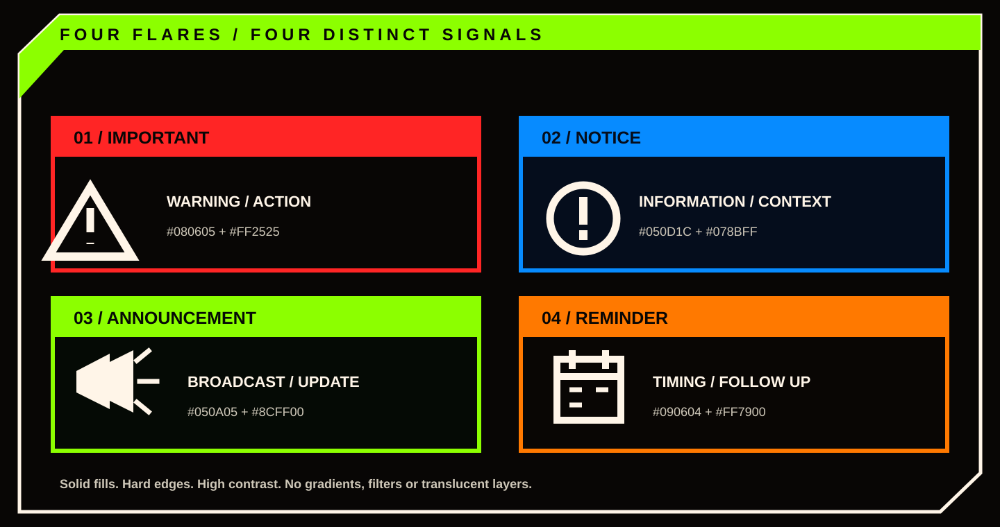

<div align="center">


**A Reddit Devvit app for publishing branded, pinned announcement comments.**

[How it works](#how-it-works) · [Announcement styles](#announcement-styles) · [Get started](#getting-started) · [Development](#development)

</div>

## Contents

- [What ModGlow does](#what-modglow-does)
- [Features](#features)
- [How it works](#how-it-works)
- [Announcement styles](#announcement-styles)
- [Publishing modes](#publishing-modes)
- [Markdown support](#markdown-support)
- [Getting started](#getting-started)
- [Usage](#usage)
- [Configuration and limits](#configuration-and-limits)
- [Architecture](#architecture)
- [Project structure](#project-structure)
- [Development](#development)
- [Security and moderation](#security-and-moderation)
- [Troubleshooting](#troubleshooting)
- [Contributing](#contributing)
- [License and third party notices](#license-and-third-party-notices)

## What ModGlow does

ModGlow turns a moderator written announcement into a branded image comment. A moderator starts from a Reddit post menu, chooses one of four announcement styles, writes the message, and publishes it through the ModGlow app account.

The result is **one top level comment under the selected post**. Its SVG artwork is rendered to PNG and placed first in the comment. When the separate body option is enabled, native Reddit rich text follows the image in that same comment. ModGlow then distinguishes and pins the comment and reads it back to verify the saved state.

ModGlow does not create a separate Reddit post or publish as the moderator who opened the form.

## Features

- **Four distinct flair designs:** IMPORTANT, NOTICE, ANNOUNCEMENT and REMINDER each have their own composition, icon and colour palette.
- **Two image layouts:** render a short message inside the SVG, or publish a title image followed by native Reddit text.
- **Markdown conversion:** headings, emphasis, lists, quotes, code, horizontal rules and safe links in separate body mode.
- **App authored publishing:** comments are submitted using the ModGlow app identity.
- **Pin verification:** the app checks Reddit's persisted moderator distinction and stickied state before reporting success.
- **In place editing:** moderators can update a verified ModGlow announcement without creating a replacement comment.
- **Permanent deletion:** moderators can explicitly confirm deletion of a verified app owned announcement.
- **Optional rules link:** append a link to the current subreddit's rules. This option is off by default.
- **Duplicate protection:** a per post Redis lock reduces overlapping publish, edit and delete operations.

## How it works

The moderator menu opens a native Devvit form. Hono routes validate the request and moderator permissions, then coordinate SVG rendering, media upload, rich text construction and Reddit comment operations.


### Publishing sequence


1. A moderator opens a Reddit post menu and selects **Create ModGlow announcement**.
2. The form collects the flair, Markdown source, image layout choice and optional rules link.
3. The server verifies moderator permission and confirms the selected post belongs to the active subreddit.
4. ModGlow acquires a per post Redis lock, builds the selected SVG, rasterises it to PNG and uploads the image to Reddit media hosting.
5. The app builds one rich text comment. The image is the first content node. Separate body mode appends parsed Markdown, followed by the optional rules link and subreddit attribution.
6. The app submits the top level comment, distinguishes it as a moderator and pins it.
7. ModGlow fetches the comment again. Success requires both `stickied === true` and `distinguishedBy === 'moderator'`.
8. When the comment is verified, ModGlow stores ownership and source metadata for later editing and deletion.

If Reddit confirms a pin mismatch, ModGlow attempts to delete the incomplete app authored comment. If submission or verification has an ambiguous result, the app warns the moderator to inspect the post before retrying and preserves the short lock until it expires.

## Announcement styles

Each flair is a separate composition, not one generic card with a different label.



| Flair | Background | Accent | Visual motif |
| --- | --- | --- | --- |
| **IMPORTANT** | `#080605` | `#FF2525` | Warning triangle, red panel and ivory title |
| **NOTICE** | `#050D1C` | `#078BFF` | Information symbol, blue panel and ivory title |
| **ANNOUNCEMENT** | `#050A05` | `#8CFF00` | Megaphone, ivory icon tile and lime title |
| **REMINDER** | `#090604` | `#FF7900` | Calendar, ivory icon tile and orange title |

The templates use solid fills, strong outlines and high contrast typography. The announcement artwork does not use gradients, filters, translucent layers, external assets or embedded raster images.

The maintained [compact announcement SVG](assets/branding/svg/announcement-card-sample.svg) demonstrates text inside the image. The [title only SVG](assets/branding/svg/announcement-title-only-sample.svg) demonstrates the image used above a native Markdown body. Both are source examples for the ANNOUNCEMENT flair.

## Publishing modes

The **Publish Markdown below the SVG** toggle is on by default for new announcements.

| Mode | Behaviour | Limit |
| --- | --- | --- |
| Toggle on | Fixed title only SVG followed by native Reddit rich text in the same comment. | 9,000 grapheme clusters |
| Toggle off | The announcement text is rendered inside the SVG image. | 2,600 grapheme clusters and 24 rendered lines |

The title only SVG is **2000 × 600**. Compact mode uses a 2000px wide canvas whose height is calculated from the wrapped text. Compact mode rejects content that exceeds its line limit rather than clipping it.

The **Include a link to subreddit rules and guidelines** toggle is off by default. When enabled, the link is appended below the image or Markdown body.

## Markdown support

Separate body mode converts the supported Markdown subset into native Reddit rich text.

| Markdown | Output |
| --- | --- |
| `# Heading` through `###### Heading` | Semantic headings |
| `**bold**` | Bold text |
| `*italic*` | Italic text, while the normal body style remains bold |
| `***bold italic***` | Bold and italic text |
| `~~strikethrough~~` | Strikethrough |
| `inline code` | Monospace text |
| Fenced code using backticks or tildes | Monospace code block |
| `- item` or `1. item` | Unordered or ordered list |
| `> quote` | Blockquote |
| `---` | Horizontal rule |
| `[label](https://example.com)` | Clickable HTTP or HTTPS link |
| `` | The image alt text only |

Ordinary body text is bold by default. Explicit italic and strikethrough are retained. Inline and fenced code remain monospace without inheriting the default bold style. Links are clickable only when their scheme is HTTP or HTTPS.

### Parser boundaries

- Paragraph soft breaks are joined as spaces. A trailing backslash creates an explicit hard line break.
- Markdown tables are not converted into structured Reddit tables.
- Nested and indented lists are not converted into nested list structures. List markers must begin at the start of a line.
- Reddit numbers ordered lists from 1.
- Inline emphasis inside semantic headings is not retained.
- Link parsing supports balanced single level parentheses.
- Unsafe link schemes are reduced to plain text labels.
- Markdown images are represented by alt text. ModGlow does not fetch or embed external images.
- Raw HTML is treated as text and is not executed or interpreted as markup.

Compact SVG mode supports the main inline styles and block prefixes, but links are displayed as readable labels rather than clickable links.

### Example input

```md
# Important update

**The maintenance window starts at 22:00 UTC.**

Please save your work before then.

- New submissions will be paused.
- Existing posts remain available.

> We will post an update when maintenance is complete.

[Read the status page](https://status.example.com)
```

The composer is Devvit's native menu form. It accepts Markdown source but does not provide custom formatting toolbar buttons or cursor selection controls.

## Getting started

### Requirements

- **Node.js 24.18.0 or newer**, as declared in `package.json`.
- npm.
- A Reddit account with moderator access to a test subreddit.
- A Reddit developer account and the Devvit CLI.
- Access to this repository.

### Install

```bash
git clone https://github.com/Kaelith69/modglow.git
cd modglow
npm ci
```

Authenticate with Devvit:

```bash
npm run login
```

Start a Reddit playtest:

```bash
npm run dev
```

Follow the Devvit CLI prompts to select the playtest subreddit. The ModGlow post menu is available to moderators on posts in that subreddit.

## Usage

### Publish an announcement

1. Open a post in a subreddit where you are a moderator.
2. Open the post menu and select **Create ModGlow announcement**.
3. Choose IMPORTANT, NOTICE, REMINDER or ANNOUNCEMENT.
4. Write the announcement using the supported Markdown syntax.
5. Keep **Publish Markdown below the SVG** enabled for a title image with native text beneath it, or disable it for a compact image.
6. Enable the rules link only when it is needed.
7. Select **Publish**.

The app publishes one top level comment. It reports success only after Reddit confirms that the comment is both moderator distinguished and pinned.

### Edit an announcement

Open the menu on a verified ModGlow announcement comment and select **Edit ModGlow announcement**. The form is prefilled from the saved metadata. Saving edits the existing comment in place. ModGlow verifies the edited body and restores the previous pin and moderator distinction state where supported.

### Delete an announcement

Open the menu on a verified ModGlow announcement comment and select **Delete ModGlow announcement**. Confirm the permanent deletion in the form. The deletion route verifies app ownership and announcement metadata before calling the app comment's delete operation.

Only comments with matching ModGlow ownership metadata are eligible for these management actions. Older comments without the required metadata cannot be safely reconstructed and are not editable or deletable through these actions.

## Configuration and limits

There are no user managed environment variables in the current app configuration. The Devvit app identity, moderator Reddit scope, media and Redis permissions, menu entries and form routes are declared in `devvit.json`.

| Setting | Current value |
| --- | --- |
| Supported announcement flairs | 4 |
| Compact SVG input | 2,600 grapheme clusters maximum |
| Compact SVG layout | 24 rendered lines maximum |
| Native Markdown body | 9,000 grapheme clusters maximum |
| SVG width | 2,000 px |
| Title only SVG | 2,000 × 600 px |
| Compact body type | 76 px |
| Compact line spacing | 100 px |
| Per post lock lease | 45 seconds |

SVG text declares `Arial, Helvetica, sans-serif`. The PNG rasterizer uses bundled IBM Plex Sans as its deterministic sans serif fallback when Arial and Helvetica are unavailable. Bundled font assets cover Latin, Malayalam and Tamil. Other scripts should be visually checked in compact SVG mode. Separate body mode uses Reddit's native text rendering.

## Architecture

The runtime is split into small modules:

- `src/index.ts` creates the Hono server and mounts the menu and form routes.
- `src/routes/menu.ts` registers the moderator actions and builds the native forms.
- `src/routes/forms.ts` validates requests, checks moderator permissions, coordinates locks, uploads images, submits comments and manages verified announcements.
- `src/core/render.ts` builds the four SVG flair templates and lays out compact announcement text.
- `src/core/rasterize.ts` converts SVG to PNG using Resvg WebAssembly and bundled fonts.
- `src/core/markdown.ts` parses the supported Markdown subset into typed blocks and inline runs.
- `src/core/richtext.ts` builds Reddit rich text comments, rules links and attribution.
- `src/core/moderation.ts` contains moderator permission and Reddit resource guards.
- `src/core/announcement.ts` validates persisted ownership metadata and edit or delete eligibility.

Reddit is the source of truth for comment state. Redis is used for short lived per post locks and metadata needed to manage app authored announcements.

See [Implementation notes](docs/IMPLEMENTATION.md) for the request sequence, validation rules and failure handling details.

## Project structure

```text
modglow/
├── .github/
│   └── workflows/
│       ├── ci.yml
│       └── deploy-devvit.yml
├── assets/
│   ├── branding/
│   │   ├── BRAND-GUIDE.md
│   │   ├── LAYOUT-AUDIT.json
│   │   ├── UPLOAD-CHECKLIST.md
│   │   └── svg/
│   │       ├── announcement-card-sample.svg
│   │       ├── announcement-title-only-sample.svg
│   │       ├── modglow-icon.svg
│   │       ├── modglow-wordmark-dark.svg
│   │       └── modglow-wordmark-light.svg
│   └── modglow-icon.png
├── docs/
│   ├── assets/
│   │   ├── architecture.svg
│   │   ├── flair-system.svg
│   │   ├── modglow-footer.svg
│   │   ├── modglow-hero.svg
│   │   └── publishing-flow.svg
│   └── IMPLEMENTATION.md
├── src/
│   ├── core/
│   ├── routes/
│   └── index.ts
├── devvit.json
├── package.json
└── README.md
```

## Development

Install dependencies with `npm ci`, then use the following scripts from `package.json`.

| Command | Purpose |
| --- | --- |
| `npm run check` | Run type checking, unit tests, ESLint and the production build |
| `npm run typecheck` | Run TypeScript without emitting files |
| `npm run test:unit` | Run the Node.js unit test suite |
| `npm run lint` | Run ESLint on TypeScript source |
| `npm run build` | Build the Devvit app with Vite |
| `npm run dev` | Start a Devvit playtest |
| `npm run login` | Authenticate with Devvit |
| `npm run deploy` | Run `npm run check`, then `devvit upload` |
| `npm run launch` | Run the deploy script, then `devvit publish` |

CI runs `npm ci`, `npm audit --audit-level=moderate` and `npm run check` on pushes and pull requests. See [the CI workflow](.github/workflows/ci.yml).

## Security and moderation

- The menu is registered for moderators, and the server independently checks for the `posts` or `all` subreddit permission.
- The selected post is checked against the active subreddit by name and immutable subreddit ID.
- Removed and archived posts are rejected before image rendering and upload. Locked posts remain eligible for moderator comments.
- User supplied text is escaped before it is inserted into SVG markup.
- Only HTTP and HTTPS links become clickable. External Markdown images are never fetched.
- The app publishes with its own Devvit identity, not the invoking moderator's identity.
- Edit and delete actions require the current app account, comment identity, parent post, subreddit identity and saved ModGlow metadata to match.
- Permanent deletion requires explicit confirmation.
- If comment submission or verification has an ambiguous result, ModGlow asks the moderator to inspect the post before retrying.

ModGlow does not edit or delete another user's comments.

## Troubleshooting

**The ModGlow menu item is missing**

- Confirm the app is installed or running in the target subreddit.
- Open the menu from a post.
- Confirm your account has moderator access.

**The form refuses to publish**

- Enter announcement text and choose one of the four supported flairs.
- Check the character limit for the selected publishing mode.
- Confirm the post is not removed or archived.
- Confirm the app has the required Reddit, media and Redis permissions.

**The app says to check the post before retrying**

Reddit may have accepted a comment even if the request response or verification read failed. Inspect the post before submitting again. ModGlow deliberately avoids an immediate retry when that could create duplicates.

**The compact image rejects the text**

Shorten the announcement, reduce the number of wrapped lines or enable the separate Markdown body. Compact mode has a 2,600 grapheme limit and a 24 line layout ceiling.

**An older announcement cannot be edited or deleted**

Management actions require saved ownership metadata. Comments published before that metadata was introduced cannot be safely reconstructed from their rendered image.

## Contributing

Contributions are welcome.

1. Read the implementation notes and brand guide before changing publishing or visual behaviour.
2. Keep changes within the existing feature boundaries unless a broader change is required.
3. Add or update regression tests for changed behaviour.
4. Run `npm run check`.
5. Update the README, implementation notes, brand guide or changelog when behaviour changes.

For bugs and feature requests, use the [GitHub issue tracker](https://github.com/Kaelith69/modglow/issues). Include reproduction steps, expected behaviour and relevant logs with private information removed.

## License and third party notices

ModGlow is released under the [MIT License](LICENSE).

Bundled third party assets and their licences are listed in [THIRD_PARTY_NOTICES.md](THIRD_PARTY_NOTICES.md). These include IBM Plex Sans, Noto Sans Malayalam, Noto Sans Tamil and Resvg WebAssembly.

<div align="center">


</div>
